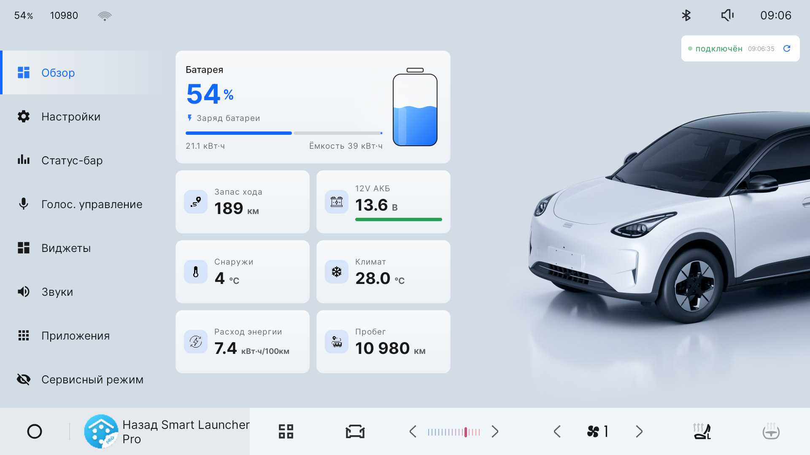

# EX2ToolsIV



Локальный инструмент для головного устройства **Geely EX2** на Flyme Auto.
Приложение собрано вокруг одной идеи: максимум полезных функций без облака,
без телеметрии, без удалённого управления и без автоматических обновлений.

> Проект не связан с Geely, Meizu или Flyme Auto. Это независимая open-source
> разработка. Установка и использование выполняются на свой риск.

## Почему без интернета и автообновлений

Это осознанное решение, а не отсутствие функций.

- **Нет внешних сетевых запросов.** Приложение не обращается к серверам,
  не отправляет аналитику, не загружает конфигурацию и не проверяет обновления.
- **Нет автообновлений.** Обновление — только вручную: собрать/скачать APK,
  проверить хэш и установить. Приложение не может само подменить свой код.
- **Нет динамической загрузки кода.** В APK нет плагинов, dex-загрузки,
  WebView с удалённым кодом и скрытых загрузчиков.
- **Нет телеметрии и crash-reporting.** Логи и скриншоты остаются локально.
- **Меньше поверхности атаки.** Вредоносный код не может попасть в приложение
  через «тихое» обновление, подменённый сервер или удалённый конфиг.

Разрешение `INTERNET` в манифесте используется только для **локальных**
сокетов:

- встроенный QR-сервер для передачи APK с телефона на ГУ в одной Wi-Fi сети;
- локальный ADB-клиент для скриншотов через `127.0.0.1`.

Внешних HTTP(S)-запросов в коде нет. Установка APK из QR/USB — это действие,
которое пользователь запускает сам; это не автообновление приложения.

## Изменения в этом форке

- Голосовые сценарии подогревов в «Мои команды»: своя фраза и несколько действий
  для руля, каждого сиденья, лобового и заднего стекла. Команды можно отключать,
  изменять и удалять. При первом обновлении добавляются редактируемые стандартные
  команды; существующие команды приложений сохраняются. Удалённые записи не
  восстанавливаются автоматически. Дополнительные фразы редактируются там же.
- Переключатель «Привязка к углам»: overlay-виджеты выстраиваются колонками;
  свободные позиции сохраняются отдельно и возвращаются при отключении режима.
- «Подогнать размеры климата» задаёт ширину температуры 420 dp и размер обогревов 420 × 240 dp. При выключении используются исходные размеры.
  Для совпадения ширины у виджетов должен быть одинаковый процент размера.
- У виджетов обдува есть переключатель между штатными пятью режимами и тремя кнопками «Лицо», «Ноги», «Стекло». В режиме трёх кнопок поддерживаются
  сочетания «Лицо + ноги» и «Ноги + стекло»; неподдерживаемое сочетание
  заменяется последним выбранным направлением. Повторный тап убирает
  направление из сочетания, единственное активное направление не отключается.
- Раздел «Кнопки руля»: двойное короткое нажатие голосовой кнопки переключает
  режим климата; громкость +/− меняет температуру, треки — скорость вентилятора.
  Через 15 секунд без управляющих нажатий возвращается обычный режим.
  Распознавание речи и микрофон для этого режима не требуются.

Для перехвата штатных действий кнопок нужен отдельный патч сервиса конкретной
версии ГУ. Исходники, сборка и откат описаны в
[tools/steering-patch/README.md](tools/steering-patch/README.md).
Патч по умолчанию не активен; его работа на ГУ ещё не проверена.
APK, оригинальный системный сервис и ключи подписи в git не включены.
Иконки сохранены из исходного проекта.

## Что нового в 2.0.8

- Вся работа с автомобилем переведена на новую схему:
  `VhalGateway → CapabilityRegistry → CommandDispatcher`, единое состояние
  через `VehicleState` (подписки на события + опрос как страховка).
- Виджеты перерисованы: единый стиль, светлая и тёмная тема, крупные
  подписи и иконки, отдельные PNG-иконки для обогревов руля и стёкол.
- Автоблокировка экрана: после бездействия открывается экран блокировки
  (30 секунд / 1 минута / 5 минут), выход двойным тапом.
- Удержание режима движения и рекуперации: запрос повторяется после
  загрузки, пробуждения экрана и смены передачи; ручное переключение
  в штатном меню не перебивается.
- Спидометр: пробег поездки и его сброс с подтверждением, шаг шкалы 20 км/ч,
  крупные цифры, настройки применяются сразу.
- Чистая установка с флешки: отдельный `update.zip` и скрипт подготовки
  флешки для Windows (формат, запись и проверка).
- Мелкие исправления: заряд в статус-баре обновляется по событию,
  уровни обогрева сидений независимы, TTL 65 и фон камеры заднего хода
  включаются штатно, режимы движения применяются и на ходу.

## Возможности

### Обзор

- заряд батареи, остаток энергии и запас хода;
- напряжение 12 В с полосой состояния;
- температура снаружи и целевая температура климата;
- средний расход и пробег;
- анимация зарядки: волна, блик и пульсирующая молния;
- отдельные иконки плиток, адаптированные под светлую и тёмную тему.

### Настройки

- режимы вождения: Eco / Comfort / Sport;
- рекуперация: слабая / средняя / сильная;
- автоматическое применение режимов;
- удержание режима движения и рекуперации после загрузки и смены передачи;
- автоблокировка экрана (30 секунд / 1 минута / 5 минут);
- отключение автоматической блокировки дверей при движении;
- затемнение экрана заднего хода для EX2 PRO;
- TTL 65 для IPv4 и IPv6;
- светлая, тёмная и системная тема;
- плавающая кнопка скриншота;
- плавающая кнопка таск-менеджера;
- «Мои команды» для голосового управления;
- сброс настроек приложения.

### Статус-бар

- Wi-Fi, батарея, температура, общий и суточный пробег, яркость;
- заряд обновляется по событию, пробег показывается с десятыми и
  сбрасывается по нажатию на иконку;
- настройка порядка иконок;
- интервал обновления;
- управление яркостью;
- собственные иконки уведомлений.

### Голосовое управление

- полностью офлайн-распознавание русского языка;
- активация по фразе «Слушай Джили»;
- кнопка микрофона на руле;
- мини-overlay состояния;
- управление климатом, окнами, светом, яркостью, громкостью, режимами
  вождения и приложениями;
- пользовательские команды для приложений и сценариев подогревов;
- несколько подогревов с независимыми уровнями для одной фразы;
- редактируемые стандартные команды и дополнительные фразы в «Мои команды»;
- встроенный справочник доступных команд.

После активации «Слушай Джили» доступны отдельные команды подогрева:

- «Включи подогрев руля» / «Выключи подогрев руля»;
- «Подогрев водительского сиденья на один / два / три»;
- «Подогрев пассажирского сиденья на один / два / три»;
- «Выключи подогрев водительского сиденья»;
- «Выключи подогрев пассажирского сиденья».

Для сидений произносится один выбранный уровень: например, «Подогрев
сиденья пассажира на два». Также поддерживается слово «обогрев».
Команда для одного сиденья не меняет уровень другого.

### Виджеты

- набор виджетов: часы, режим вождения, рекуперация, климат, вентилятор,
  температура, обдув, обогрев, АКБ + запас хода, блокировка экрана;
- overlay-виджет «Приложения»: до 9 иконок для быстрого запуска, режимы
  «в строку» и «в квадрате», выбор приложений с поиском;
- плавающие виджеты с общей привязкой к углам для штатного и сторонних домашних
  экранов, а также обычные AppWidget;
- отдельные размер и прозрачность overlay-виджетов;
- перетаскивание overlay-виджетов за фон с сохранением положения;
- спидометр 0–160 км/ч с цифровым и стрелочным режимом, темами и фоном,
  пробегом поездки и его сбросом;
- виджет АКБ + запас хода: заряд, остаток энергии в кВт·ч и оценка запаса
  хода по фактическому расходу;
- состояние «ожидание» у обогрева руля: синяя обводка до подтверждения
  автомобилем, повтор запроса в D;
- часы с датой, выбор шрифта и цвета;
- светлая и тёмная тема.

### Звуки

- 10 встроенных WAV-звуков;
- 5 заводских звуков;
- собственный WAV-файл;
- предпрослушивание;
- переключатель «Активировать»: выключение возвращает заводской звук.

### Приложения

- список пользовательских и системных приложений;
- установка APK через USB или QR;
- встроенный файловый менеджер для APK и WAV;
- удаление пользовательских приложений;
- просмотр версии, пакета и подписи;
- управление разрешениями;
- встроенный QR-сервер для передачи APK на ГУ.

### Таск-менеджер

- плавающая кнопка запуска;
- запущенные и недавние приложения;
- отметка защищённых приложений;
- закрытие выбранных приложений с отображением занятой памяти.

### Сервисный режим

- скрытие выбранных приложений;
- скрытие самого EX2ToolsIV;
- невидимые угловые триггеры;
- кнопка «Показать углы» с подсветкой зон на 5 секунд;
- ручное восстановление приложений и сервисов.

### Интерфейс

- горизонтальный автомобильный интерфейс;
- крупные элементы и типографика;
- светлая и тёмная тема;
- собственные Flyme-подобные переключатели, сегменты, карточки и диалоги;
- без облачных баннеров, рекламы и внешних ссылок.

## Архитектура

- `MainActivity` — каркас, навигация и кэш фрагментов.
- `ui/` — экраны, диалоги и кастомные компоненты.
- `vehicle/` — доступ к VHAL: `VhalGateway`, реестр возможностей,
  диспетчер команд и описания свойств.
- `state/` — `VehicleState`: подписки на события, кэш значений и опрос.
- `climate/` — климат, обогревы, сиденья и руль.
- `drive/` — режимы движения и рекуперация.
- `body/` — окна, скоростная блокировка, день/ночь.
- `car/` — телеметрия, TTL 65, фон камеры заднего хода, модель запаса хода.
- `status/` — статус-иконки, яркость, Wi-Fi, сброс пробега.
- `widgets/` — провайдеры виджетов и движок обновления.
- `voice/` — офлайн-распознавание и разбор команд.
- `apps/` — установка, удаление, разрешения, файловый менеджер и QR-сервер.
- `tasks/` — таск-менеджер и плавающая кнопка.
- `servicemode/` — скрытие приложений и угловые триггеры.
- `lock/` — экран блокировки и автоблокировка.
- `service/` — фоновые сервисы и boot/wake.
- `Prefs` — локальные настройки.
- `LogStore` — локальный журнал.

`car-stubs` — compile-only заглушки Android Car API, чтобы проект собирался
без системного `android.car.jar`.

## Сборка

Требования:

- JDK 17;
- Android SDK 34;
- Gradle Wrapper из репозитория.

Создайте `local.properties`:

```properties
sdk.dir=C:\\Path\\To\\Android\\Sdk
```

Сборка:

```powershell
$env:JAVA_HOME='C:\Program Files\Android\Android Studio\jbr'
.\gradlew.bat :app:assembleRelease --no-daemon
```

Готовый APK:

```text
app/build/outputs/apk/release/app-release.apk
```

### Подпись

Приложение использует `android:sharedUserId="android.uid.system"` и требует
платформенную подпись для системных разрешений.

Ключ **не входит в репозиторий**. Положите `signing/platform.jks` и задайте:

```properties
EX2_STORE_PASSWORD=...
EX2_KEY_ALIAS=platform
EX2_KEY_PASSWORD=...
```

в `gradle.properties` или переменных окружения. Без ключа проект соберётся
без подписи; обычная подпись не даст системный UID.

### Важные ресурсы

- `app/src/main/assets/model-ru` — офлайн-модель распознавания речи;
- `app/src/main/assets/lock_sounds` — встроенные WAV-звуки;
- `app/src/main/res/raw/voice_phrases.txt` — грамматика голосовых команд.

Без модели голосовое управление не запустится, но остальные функции
приложения будут работать.

## Установка

Приложение предназначено для системной установки на ГУ. Обычный
`adb install` на телефон или на ГУ без платформенной подписи не даст
`android.uid.system` и системные разрешения.

Перед установкой:

1. Соберите APK самостоятельно или проверьте SHA-256 готового APK.
2. Убедитесь, что подпись совместима с вашей системой.
3. Сделайте резервную копию данных ГУ.
4. Устанавливайте только на совместимую прошивку.

Некоторые функции (скриншоты, установка APK, скрытие приложений) используют
локальный ADB или системные разрешения. Это не root-эксплойт, но и не
«безопасная песочница»: приложение имеет широкие полномочия.

### Чистая установка с флешки

Для ГУ без приложения (например, после сброса к заводским настройкам) в
релизах лежат `update.zip` и архив `usb-install.zip` с готовым скриптом
для Windows. Скрипт форматирует флешку в FAT32, кладёт пакет в
`3C6025_<версия>\OS\update.zip` и проверяет запись.

1. Распакуйте `usb-install.zip`, запустите `write-usb.bat`, выберите диск
   и введите `FORMAT`.
2. Вставьте флешку в ГУ и откройте скрытое меню: «Телефон» → секретный
   код → `U盘升级`.
3. Дождитесь строки `[EX2] OK: package registered, reboot required`
   (`Installation aborted` — норма) и удерживайте кнопку «предыдущий трек»
   15 секунд.

Секретный код зависит от даты и времени ГУ: `#*` + (месяц + 10) + день +
час в 12-часовом формате. Пример для 18 ноября 2026, 14:30 — `#*211802`.

## Безопасность и приватность

- нет аналитики, рекламы, телеметрии и crash-reporting;
- нет внешних сетевых запросов;
- нет автообновлений и удалённой конфигурации;
- нет динамической загрузки кода;
- логи, настройки и скриншоты остаются на устройстве;
- QR-сервер работает только в локальной сети и использует случайный токен;
- исходный код открыт для аудита.

**Важно:** приложение работает с системным UID. Ошибка в коде или сторонняя
сборка могут повлиять на работу ГУ. Доверяйте только сборкам, которые вы
собрали сами или проверили по исходникам и хэшу.

## Ограничения

- проект рассчитан на конкретную автомобильную платформу и её Car API;
- часть свойств и идентификаторов зависит от прошивки;
- офлайн-распознавание зависит от качества микрофона и модели;
- установка виджетов и статус-иконок зависит от лаунчера и системного UI;
- без платформенной подписи системные функции недоступны;
- проект не является заменой штатных систем безопасности автомобиля.

## Лицензия

Оригинальный код проекта — **MIT**. См. `LICENSE`.

Сторонние библиотеки и ресурсы сохраняют свои лицензии. См.
`THIRD_PARTY_NOTICES.md`. Перед публикацией форка проверьте права на
графические и аудиоматериалы, включённые в APK.
